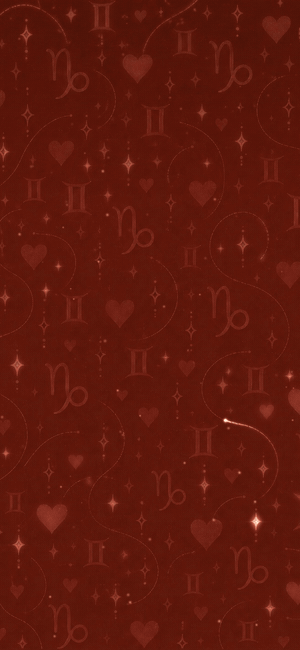
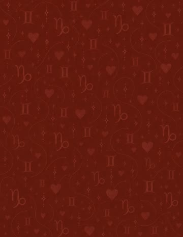
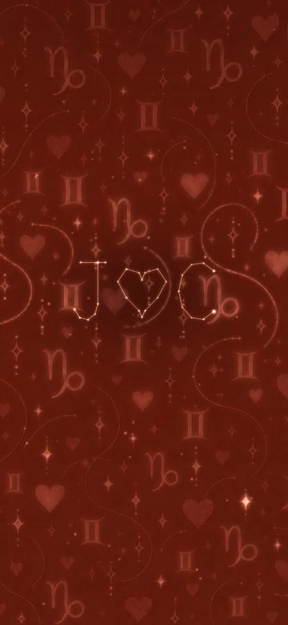
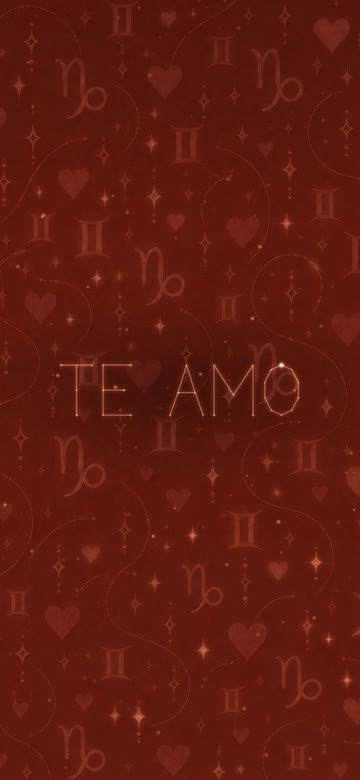

<div align="center">

# Amor Zodiacal

**Un fondo de pantalla animado para el teléfono, hecho a partir de un dibujo de mi esposa:
Géminis y Capricornio, corazones y estrellas… que titilan, laten y esconden mensajes.**

Para Samsung S24 con [Wallpaper Engine](https://www.wallpaperengine.io).



▶️ **[Ver el video completo (v2, 30 s, 60 fps)](https://github.com/DeveloperJGV/amor-zodiacal-wallpaper/releases/download/v3/amor_zodiacal_v2.mp4)**

</div>

## ¿Qué es?

Un regalo. La ilustración original es un fondo fijo; aquí se volvió un wallpaper vivo.

La idea central: **no se le ponen efectos genéricos encima al dibujo**. Primero se separa el dibujo en sus
piezas (cada estrella, cada corazón, cada signo, cada camino punteado) y luego se anima cada pieza por su
cuenta. Así el dibujo se sigue viendo como el dibujo, solo que respira.

## Capturas

<table>
  <tr>
    <td width="33%"><br><b>Original</b>: el dibujo tal cual.</td>
    <td width="33%"><br><b>Constelaciones</b>: las estrellas se unen y escriben nuestras iniciales.</td>
    <td width="33%"><br><b>Mensajes</b>: TE AMO, la fecha de la boda y, el día del aniversario, una sorpresa.</td>
  </tr>
</table>

## Versiones

| Versión | Tipo | Qué tiene |
| --- | --- | --- |
| **v1** | Video, 10 s, 30 fps | Estrellas que titilan, corazones que laten, signos que respiran, una ola de luz y partículas. |
| **v2** | Video, 30 s, 60 fps | Todo lo de v1, más constelaciones que se dibujan solas (J ♥ C, TE AMO, 18·10·25), cometas que recorren los caminos punteados, un secreto en morse y la zona del reloj más tenue para la pantalla de bloqueo. |
| **v3** | Scene interactiva (beta) | Igual que v2, pero en vivo: efecto 3D al inclinar el teléfono, corazones dorados al tocar la pantalla, modo noche y una sorpresa el 18 de octubre. |

### Lo de la v3

- **Profundidad**: cada estrella, corazón y signo es una capa propia a distinta distancia; al inclinar el
  teléfono se mueven distinto y se siente en 3D.
- **Toca la pantalla**: salen corazones dorados donde tocas.
- **Modo noche**: de 22:00 a 6:00 todo baja de brillo.
- **Aniversario**: el 18 de octubre aparece **FELIZ ANIVERSARIO** escrito en las estrellas.
- **Opciones** en Wallpaper Engine: intensidad del brillo y mostrar/ocultar los mensajes.

### El secreto en morse

Una de las estrellas grandes, abajo a la derecha, no titila como las demás:
parpadea `- . / .- -- ---` = **TE AMO**, dos veces en cada ciclo de 30 segundos.

## Descargas

Los videos listos para usar están en [Releases](https://github.com/DeveloperJGV/amor-zodiacal-wallpaper/releases)
y también en la carpeta [`releases/`](releases):

| Archivo | Para qué |
| --- | --- |
| `amor_zodiacal_v2.mp4` | Video H.264, funciona en cualquier lado. |
| `amor_zodiacal_v2_hevc.mp4` | Video HEVC, pesa la mitad (S24 y teléfonos recientes). |
| `amor_zodiacal.mp4` | La v1, más corta y sencilla. |
| `releases/v3/amor_zodiacal_v3/` | El proyecto Scene interactivo para Wallpaper Engine. |

## Cómo usarlo

**Con video (v1 o v2):** pasa el `.mp4` al teléfono, ábrelo en Wallpaper Engine y ponlo como fondo
(o usa la opción de fondo de video de tu teléfono).

**Con la Scene (v3):** copia la carpeta `releases/v3/amor_zodiacal_v3` a los proyectos de Wallpaper Engine
en la PC y mándala al teléfono con la app de Wallpaper Engine para Android.

## Cómo regenerarlo

Necesitas Python 3.11+ y [FFmpeg](https://ffmpeg.org) en el `PATH`.

```bash
git clone https://github.com/DeveloperJGV/amor-zodiacal-wallpaper.git
cd amor-zodiacal-wallpaper
python -m venv venv && venv/Scripts/pip install -r requirements.txt

venv/Scripts/python src/v2/segment.py                 # separa el dibujo en piezas -> build/seg_v2.pkl
venv/Scripts/python src/v2/build.py                   # video v2 -> releases/v2/
venv/Scripts/python src/v3/build_scene.py --install   # Scene v3 -> Wallpaper Engine
```

La v3 se arma **sin abrir el editor de Wallpaper Engine**: el script escribe directamente las texturas
`.tex` (RGBA8888 comprimidas con LZ4), los modelos, las partículas y el `scene.json`. Un script
(`director.js`) dentro de la escena se encarga de toda la animación en vivo.

## Estructura

```
Wallpaper001.jpeg        ilustración original
src/seg.py, render.py    v1
src/v2/                  v2: segment.py (análisis del dibujo), glyphs.py (letras de estrellas), render.py, build.py
src/v3/                  v3: build_scene.py (arma la Scene), director.js (animación en vivo), tex.py (texturas)
releases/vN/             resultados listos para usar
docs/                    imágenes de este README
```

## Créditos

- **La ilustración** es de mi esposa. Es lo más importante de todo esto.
- El código y la animación: [DeveloperJGV](https://github.com/DeveloperJGV).

## Licencia

El **código** es [MIT](LICENSE): tómalo y haz tu propio wallpaper.

La **ilustración** (`Wallpaper001.jpeg` y todo lo que sale de ella: videos, texturas, capturas) **no** entra en
esa licencia: es de su autora y todos los derechos son suyos. Si quieres usar el código, usa tu propio dibujo. 💛
